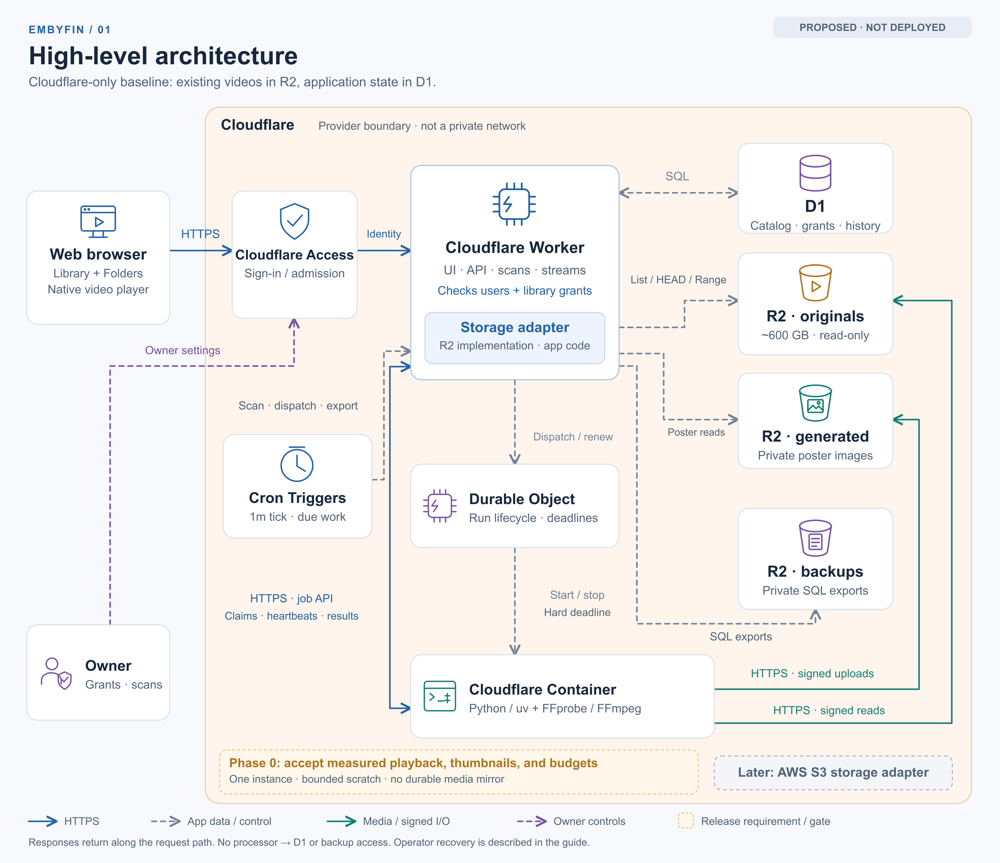
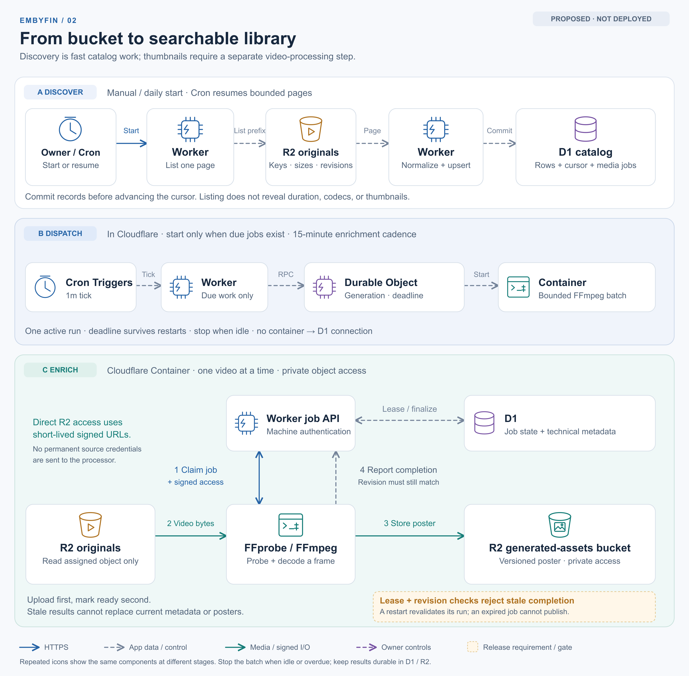
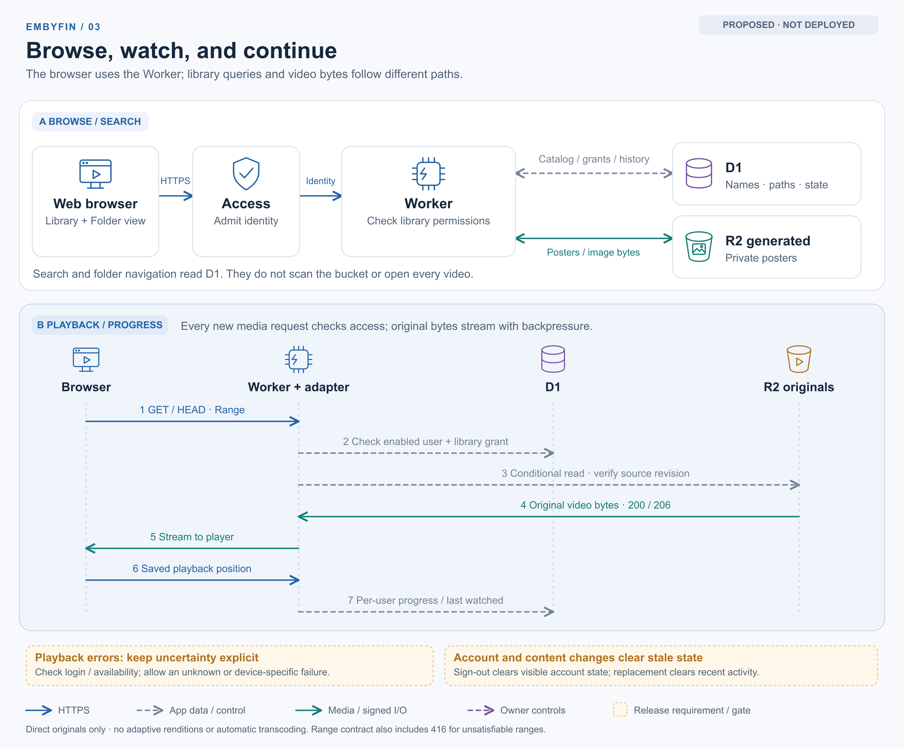

# Embyfin architecture and data flows

These diagrams describe the revised Cloudflare-only baseline in [PRD.md](../../PRD.md), not a deployed system. The committee recommendations are now incorporated. Amber notes highlight release requirements and acceptance gates. Functional icons represent components; provider boundaries do not imply private networks.

## 1. High-level architecture



[Editable SVG](01-architecture.svg)

The Worker serves the application and enforces per-library access after Cloudflare Access admission. D1 stores the catalog, permissions, viewing state, and jobs. Existing originals remain in a private R2 bucket; generated posters and SQL backups use separate private buckets. The storage adapter is application code, with AWS S3 deferred.

Cloudflare Containers is the default candidate for FFprobe/FFmpeg processing. A Worker dispatches through one Durable Object controller, which manages one named instance, run generation, activity renewal, and an absolute deadline. The processor obtains jobs through the machine-authenticated Worker and uses short-lived signed URLs for assigned R2 objects. It does not connect directly to D1, receive backup access, or keep a durable copy of the video collection. The controller keeps minimal lifecycle state; D1 remains the job authority.

The job callback API has separate machine authentication; it does not require interactive viewer login. The overview shows requests, with responses returning along the same paths. It omits deployment tooling and detailed operator recovery steps.

## 2. Scanning and thumbnail generation



[Editable SVG](02-ingestion.svg)

Scanning captures keys, sizes, and revision information into D1. A separate processor extracts technical metadata and a video frame. Posters are uploaded before the Worker marks a matching job revision ready. Repeated icons show stages involving the same services.

Daily scan starts, one-minute Cron continuation/dispatch ticks, and a 15-minute enrichment cadence are provisional. Cron advances durable scan checkpoints independently of an open browser. A failed scan must not clear the catalog, and marking an object missing requires a completed scan plus an absence check. Paused scans stay paused across scheduled ticks.

The dispatch stage starts a bounded batch only when due work exists. Heartbeats must match the active run/job lease; background decoding alone does not renew the container's activity timer. The controller enforces a separate deadline, and idle or overdue batches stop. A restarted entrypoint revalidates its generation/deadline before doing work. Representative-video tests must validate resource limits and actual shutdown behavior before launch.

## 3. Browsing, playback, and progress



[Editable SVG](03-viewing.svg)

Browsing and search query D1. Posters and original video bytes pass through authenticated Worker endpoints. Access admission alone does not grant library access. Access is shown in the browse flow and omitted from the playback sequence for readability; it still protects browser requests.

The sequence shows successful original playback. The implementation must also handle authentication failures, source changes, unavailable objects, unsupported or unknown playback failures, and unsatisfiable ranges. Playback does not transcode originals or generate adaptive renditions.

Sign-out stops media and clears account-scoped visible state before managed logout. Switching accounts cannot replay old unsent writes under the new identity. Same-key content replacement resets current viewing activity, including Recently Watched, while preserving favorites. A generic player failure is not evidence that a video is unsupported everywhere.

## Recovery and validation boundaries

Scheduled export steps stream consistent SQL backups into the private backup bucket and retain their manifests outside D1. Exports block D1 requests, so processing is drained and scan/job claims are suspended during export. Daily backups, 30-day retention, a 24-hour data-loss target, and a four-hour operator recovery target remain provisional requirements.

Both in-place Time Travel and isolated-database restoration use an operator-controlled maintenance gate outside D1. Recovery stops traffic/schedules/processing, invalidates restored leases, and reconciles authorization before reopening. If current grants are unavailable, restored viewer access stays disabled until owner reapproval. The runbook, operator credentials/configuration references, backup health reporting, and alert delivery must work without the application UI. These operational details are specified in PRD section 9.

No representative media workload has been run. The owner must accept measured playback coverage, thumbnail yield, resource/cost limits, backup targets, and non-overlapping sharing prefixes. One provider simplifies the proposed deployment; it does not establish lower cost or universal format compatibility. Current official sources are linked in the PRD.

## Editing and verification

SVGs retain editable text and vector shapes. PNGs are rendered at twice the SVG dimensions for sharing. Regenerate SVGs using Python's standard library:

```sh
python3 docs/diagrams/render.py
```

Rasterize the SVGs with an SVG-capable renderer, then inspect the resulting images at presentation size. The exported PNGs were rendered with the already-installed Sharp/librsvg runtime. No application or cloud resources are created by this script.
